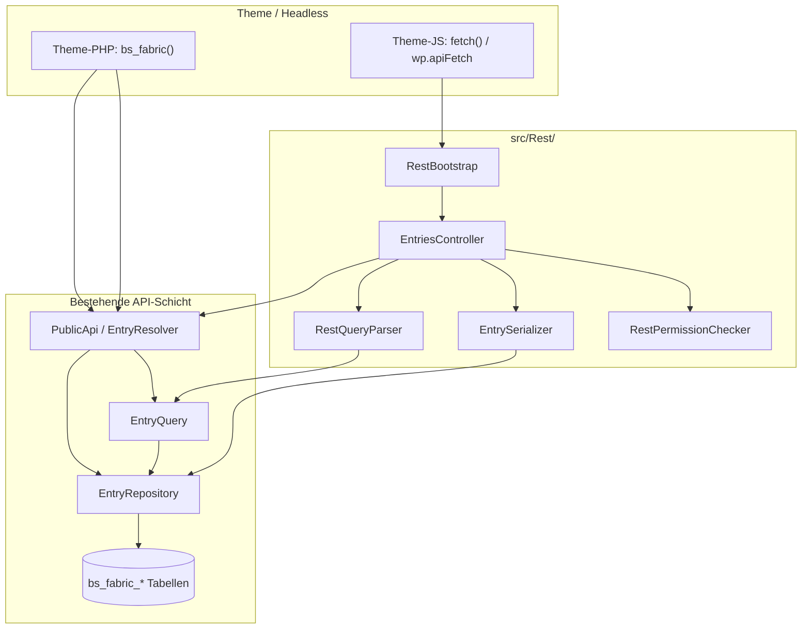

# bs-fabric — Architektur & Entwicklungsdokument
> Version 1.1 — Stand Juni 2026 (nach Design System DS-0–DS-3)
>
> **Dokumentations-Hierarchie:** [`ROADMAP.md`](ROADMAP.md) = schnelle Status-Checkliste (✓/◻).  
> [`ARCHITECTURE.md`](ARCHITECTURE.md) = Spezifikation, Schema, Sessions, Tests.  
> [`REST-API.md`](REST-API.md) = REST-Referenz für Theme-Entwickler.  
> Ergänzend: `README.md` (Install/API EN), `CODE_ANALYSIS.md`.
> Der ursprüngliche Design-Prototyp (`Design System/`) wurde nach Umsetzung von DS-0–DS-3 aus dem
> Plugin-Repo entfernt (Aug 2026, reine Referenz ohne Laufzeit-Bezug, extern archiviert) — siehe §4.

---

## 1. Produktvision

**Ein Satz:** ProcessWires Template/Field/Entry-Philosophie als WordPress-Plugin —
visuell für Redakteure, sauber für Entwickler.

**Name:** bs-fabric — ein Gewebe aus Daten, Feldern, Relationen.
Alles hängt zusammen, nichts steht für sich.
Namensraum: `BsFabric\` — Prefix: `bs_fabric_` — API: `bs_fabric()`

**Was es ist:**
- Visueller Template-Builder (Templates definieren, Felder zuweisen)
- Globale Felderbibliothek (Felder sind wiederverwendbare Objekte)
- Sauberer Entry-Editor (nur die Felder des Templates, kein WP-Chaos)
- Chainbare PHP-API `bs_fabric()` für Entwickler im Frontend

**Was es nicht ist:**
- Kein Page Builder
- Kein Gutenberg-Ersatz
- Kein No-Code-Tool für Endkunden
- Kein ACF-Clone

**Warum nicht ACF?**
ACF Pro 6.x kommt näher, aber es fehlt fundamental:
1. Kein echtes relationales Denken — bidirektionale Relationen sind Handarbeit
2. Keine Query-API — man baut immer noch WP_Query mit meta_query
3. Kein View Layer — ACF liefert Daten, Darstellung ist Thema-Aufgabe
4. Keine konzeptuelle Trennung zwischen Schema und Instanz

**Langfristige Richtung (Feature-Roadmap B2+):**
Der `code`-Feldtyp öffnet die Möglichkeit, Templates mit Input- und
Output-Code auszustatten — analog zu REDAXO-Modulen (**DesignBlocks**:
wiederverwendbare Input-/Output-Snippets pro Template, ohne Gutenberg).
Das Plugin wird damit zur Grundlage eines leichtgewichtigen Block-Editors
ohne Gutenberg-Komplexität. Details: §5 (geplante Feldtypen), [`ROADMAP.md`](ROADMAP.md).

---

## 2. Technische Leitplanken

| Thema | Entscheidung |
|---|---|
| PHP-Version | 8.2+ |
| WordPress-Minimum | 7.0 |
| Autoloading | PSR-4 via Composer |
| Storage | Komplett eigene Tabellen — kein Post Meta, kein CPT |
| Admin UI | **Hybrid-Shell:** WP-Admin-Menü links bleibt, Content-Bereich in `.bsf-app` (`AdminShell`) |
| Admin JS | Vanilla JS (`bsf-ui.js`, `bsf-schema.js`, `admin.js`) — **Explorer** = einzige React-Ausnahme |
| Admin CSS | Design System unter `assets/css/bsf-*.css`, scoped auf `.bsf-app` — Herkunfts-Prototyp extern archiviert (Aug 2026) |
| Tabellarische Ansicht | Custom `bsf-tbl` in PHP-Screens; Explorer nutzt React-Bundle + DataViews-Skin |
| Queries | Direkt via `$wpdb->prepare()` — kein ORM |
| Hooks | Standard WP Actions/Filters als Rückgrat |
| Feldtypen | Erweiterbar via `bs_fabric_field_types` Filter |
| View-Templates | Überschreibbar via Theme (`/bs-fabric/`) |
| Namensraum | `BsFabric\` |
| Prefix | `bs_fabric_` für alle Tabellen, Options, Hooks, Funktionen |

---

## 3. Benutzerrollen & Capabilities

Zwei eigene Capabilities — nicht an WP-Rollen gekoppelt, frei zuweisbar:

| Capability | Standard | Kann |
|---|---|---|
| `bs_fabric_manage_schema` | Administrator | Templates + Fields anlegen/bearbeiten/löschen; Plugin-Konfiguration |
| `bs_fabric_manage_entries` | Administrator, Redakteur, **Mitarbeiter** | Entries in Listen anlegen, bearbeiten, löschen (gemeinsam, mit Vertretung) |
| `bs_fabric_assign_template_fields` | Administrator + Redakteur | Felder aus Bibliothek zuweisen — nur wenn Admin pro Template `editors_may_manage_fields` aktiviert hat |

WP-Rolle **`bs_fabric_mitarbeiter`** (Anzeigename: **Fabric Mitarbeiter**) wird bei Plugin-Aktivierung angelegt: nur `manage_entries`, **kein** Feld-Zuweisen.

### Redaktionsmodell (Session R1 + R2)

**Grundsatz:** Kein Entry-Ownership — alle mit `manage_entries` pflegen **alle** Datensätze in
freigegebenen Listen (Krankheitsvertretung). Fehler werden über **Audit-Log** nachvollziehbar,
nicht über Sperren.

| Rolle | Struktur (Templates/Fields) | Felder zuweisen (wenn Template erlaubt) | Daten (Entries) |
|---|---|---|---|
| **Admin** (`manage_schema`) | Alles | Alles | Alles |
| **Redakteur** (`manage_entries` + `assign_template_fields`) | Nein | Ja, pro Template-Freigabe | Alle Entries |
| **Mitarbeiter** (`manage_entries` only) | Nein | **Nein** | Alle Entries |

**Admin-Workflow:** Redakteur wünscht Liste → Admin legt Template an → Admin entscheidet:
- Felder nur selbst pflegen (Standard), oder
- Redakteure dürfen Felder aus der Bibliothek in **diesem** Template ergänzen.

**Audit (R1):** `created_by` beim Anlegen; `updated_by` bei Änderung; Log-Tabelle für
`created` / `updated` / `deleted` inkl. User und Zeitstempel.

Erweiterbar (Backlog): Granulare Capabilities pro Template-Name
(`bs_fabric_manage_entries_einrichtung` etc.) — erst nach R1 evaluieren.

### REST-API — Lesezugriff (Phase 1 ✓)

Die REST-Schicht ergänzt die PHP-API — kein Ersatz. Sie nutzt dieselben
Repositories und `EntryQuery` wie `bs_fabric()`.

| Zugriff | Bedingung |
|---|---|
| **`published` Entries** | Öffentlich ohne Authentifizierung |
| **`draft` / `archived` / `status=any`** | Nur mit `bs_fabric_manage_entries` |
| **Einzelner Draft ohne Cap** | HTTP **403** (`bs_fabric_rest_forbidden`) |
| **Unbekannter Entry / falsches Template** | HTTP **404** |

Collection-Requests mit `status=draft|archived|any` ohne Capability liefern **403**
bereits in `permission_callback` (`RestPermissionChecker::canReadEntries`).
Zusätzlich erzwingt `RestQueryParser` für nicht berechtigte Nutzer intern
weiterhin `status=published` (Defense in Depth).

Eingeloggte Redakteure: WordPress-Cookie + Header `X-WP-Nonce` (Nonce-Aktion
`wp_rest`). Externe Clients: Application Passwords (WordPress-Standard).

Details und Beispiele: [`REST-API.md`](REST-API.md).

---

## 4. Menü- und Navigationsstruktur

```
📦 Fabric                             ← Top-Level (Label konfigurierbar in Konfiguration)
   ├── Übersicht                       ← Dashboard
   ├── Explorer                        ← alle Entries, nach Template filterbar (React-UI)
   ├── Einstellungen                   ← Tabs: Templates | Fields | Doku | Konfiguration
   ├── ── Einrichtungen                 ← dynamisch pro Template (show_in_menu)
   ├── ── Ansprechpartner
   └── …                               ← weitere Template-Listen (Icon + Trennlinien im WP-Menü)
```

- Template-Untermenüpunkte werden dynamisch aus der DB generiert (`TemplateSettings::showInMenu`)
- **Einstellungen** = früher „Schema“ (`page=bs-fabric-schema`); enthält Struktur (Templates/Fields) + Doku + **Konfiguration**
- Template-Listen heben sich im WP-Sidebar-Menü visuell ab (Listen-Icon, Trennlinien) — siehe `assets/css/admin-menu.css`
- Redakteure sehen Übersicht, Explorer, Template-Punkte und Doku — nicht Templates/Fields/Konfiguration
- Legacy-URLs (`bs-fabric-templates`, `bs-fabric-fields`, `bs-fabric-docs`) leiten auf Einstellungen-Tabs um

### Admin-Design (Hybrid-Shell)

Umgesetzt in `assets/css/bsf-*.css` + `src/Admin/Components/`. Der ursprüngliche Design-Prototyp
(`Design System/`) diente nur als Handoff-Referenz für DS-0–DS-3, ist bereits vollständig in
Produktionscode überführt und wurde aus dem Plugin-Repo entfernt (Aug 2026, extern archiviert).

| Ebene | Umsetzung |
|---|---|
| WP-Sidebar | Unverändert (WP-Core-Menü); optionales Styling via `admin-menu.css` |
| Content | `.bsf-app` via `AdminShell` — Topbar, Breadcrumbs, PageHead |
| Komponenten | PHP unter `src/Admin/Components/` (`Button`, `Icon`, `StatusBadge`, …) |
| Assets | `bsf-tokens.css`, `bsf-components.css`, `bsf-wp-bridge.css`, `bsf-schema.css`, `bsf-entries.css` |
| Interaktion | Sheets, Toasts (`bsf-ui.js`), SortableJS im Template-Builder |

Kein Full-SPA — jeder Screen ist eine WP-Admin-Page mit PHP-Rendering + punktuellem JS.
---

## 5. Feldtypen

13 Feldtypen — bewusst minimal, maximal vielfältig einsetzbar.
Erweiterbar via `bs_fabric_field_types` Filter.

| Typ | Beschreibung | Typische Verwendung |
|---|---|---|
| `text` | Einzeiliges Textfeld, labelbar | Name, Titel, URL, Telefon, E-Mail |
| `textarea` | Mehrzeiliger Text, kein Markup | Kurzbeschreibung, Notizen |
| `richtext` | Editor (WP-nativ, später Tiptap) | Fließtext, Artikel |
| `image` | Einzelbild via WP Medienmanager | Titelbild, Portrait |
| `file` | Datei via WP Medienmanager | PDF, Download |
| `date` | Datum + optional Uhrzeit | Events, Fristen |
| `select` | Auswahl aus definierten Optionen | Status, Kategorie, Typ |
| `boolean` | Ja/Nein-Schalter | Feature-Flags, Zustimmungen |
| `number` | Numerischer Wert (Min/Max/Einheit) | Preis, Entfernung, Anzahl |
| `address` | Strukturierte Adresse (Straße, PLZ, Ort, Land) | Standort, Filiale, Kontaktadresse |
| `relation` | Verknüpfung zu Entries anderer Templates | Kontakt → Einrichtung |
| `reference` | Verweis auf WordPress-Inhalte (Beiträge, Seiten, Medien) | Seite verlinken, PDF aus Mediathek |
| `code` | Code-Editor mit Syntaxhighlighting | HTML-Snippets, PHP, CSS |

**Zu `code` (MVP):** Reines Speicherfeld mit CodeMirror-Editor.
Kein `eval()`, keine Ausführung. Feature-Roadmap: REDAXO-artige Module.

**Zu `relation`:** Single/Multi konfigurierbar, AJAX-Suche,
sortierbar via SortableJS, eigene Tabelle `bs_fabric_relations`.

**Zu `reference`:** Single/Multi, AJAX-Suche über WP_Query; speichert Post-IDs
in `entry_values` (nicht `bs_fabric_relations`). Abgrenzung zu `relation`.

**Zu `text`:** `name` ist der eindeutige slug-basierte Identifier
eines Feldes — nach Anlage nicht mehr änderbar. `label` ist der
Anzeigename und jederzeit editierbar.

### Geplante Feldtypen & Erweiterungen (noch nicht implementiert)

Diese Typen sind **bewusst zurückgestellt** — nicht vergessen, sondern
der Feature-Roadmap ([`ROADMAP.md`](ROADMAP.md)) zugeordnet. Der ursprüngliche Design-Prototyp
(inzwischen extern archiviert, nicht mehr im Repo) nutzte teils andere Namen (z. B. `media` statt
getrennt `image`/`file`).

| Geplant | Beschreibung | Roadmap | Anmerkung |
|---|---|---|---|
| `repeater` | Wiederholbare Feldgruppe (Label+Wert oder Sub-Felder) | Phase 4 | Braucht Schema-Erweiterung oder JSON in `entry_values` |
| `url` / `email` | Validierte Spezial-Textfelder | Phase 2 | Aktuell über `text` + Validierung im Theme |
| `gallery` | Mehrfach-Bilder (Mediathek) | Phase 2 | Prototyp: `media` mit Mehrfachauswahl |
| `multiselect` | Mehrfach-Auswahl aus Optionen | Phase 2 | Erweiterung von `select` |
| **Geo-Erweiterungen `address`** | Geocoding, Karte, Umkreissuche (Stufen A2–A6) | Phase 2–3 | Basis-Typ `address` implementiert; Details §5.1 |
| **Tiptap-Richtext** | Ersetzt/ergänzt WP-Editor in `richtext` | Phase 4 | Kein neuer Typ-Key nötig — Wechsel der Editor-Engine |
| **DesignBlocks** | `code`-Feldtyp → ausführbare REDAXO-artige Module (Input/Output-Template) | Phase 4 | Langfrist-Vision §1; kein `eval()` im MVP |
| `color` | Farbwähler | Backlog | Nice-to-have |

**Abgelehnt / bewusst anders:**
- Status `review` („In Prüfung") — Prototyp only; Produktion: `draft` \| `published` \| `archived`
- Prototyp-Feld `media` — in Produktion aufgeteilt in `image` + `file`
- **`map` / `geo` als eigener Typ-Key** — entfällt; Geo-Funktionalität lebt im Feldtyp `address` (Koordinaten als Teil des JSON-Werts)

### 5.1 Feldtyp `address` — Spezifikation & Umsetzungsplan

**Ziel:** Ein wiederverwendbarer Datenbaustein für postalische Adressen — statt drei
losen `text`-Feldern (Straße, PLZ, Stadt). Geo-Location baut darauf auf, ist aber
bewusst **in Stufen** getrennt.

**Speicherformat** (ein Wert pro Feld in `bs_fabric_entry_values`, JSON):

```json
{
  "street": "Musterstraße 1",
  "zip": "10115",
  "city": "Berlin",
  "country": "DE",
  "lat": 52.520008,
  "lng": 13.404954,
  "formatted": "Musterstraße 1, 10115 Berlin",
  "geocoded_at": "2026-06-08T12:00:00Z",
  "geocode_status": "ok"
}
```

`lat` / `lng` / `formatted` / `geocoded_at` / `geocode_status` sind optional
(Stufe 1: leer; ab Stufe 2: beim Speichern befüllt).

**Feld-Settings (Schema):**

| Setting | Default | Beschreibung |
|---|---|---|
| `require_street` | true | Straße Pflichtfeld |
| `require_zip` | true | PLZ Pflichtfeld |
| `require_city` | true | Ort Pflichtfeld |
| `show_country` | true | Land-Feld anzeigen |
| `default_country` | `DE` | Vorauswahl Land (ISO 3166-1 alpha-2) |
| `enable_geocoding` | false | Geocoding beim Speichern (Stufe 2) |
| `enable_map_picker` | false | Karte im Admin zum Pin-Feintuning (Stufe 3) |

**API / Theme:** `$entry->standort` liefert über `renderValue()` ein Array; Zugriff
z. B. `$entry->standort['city']`, `$entry->standort['formatted']`, `$entry->standort['lat']`.

**Abgrenzung:** Kein Post Meta, keine CPT-Geo-Plugins. Geocoding nur über Nominatim
(öffentlich oder eigener Endpoint in Konfiguration → Geo) — kein Google Maps.

**Umsetzungsstufen (Reihenfolge bindend):**

| Stufe | Inhalt | Roadmap | Definition of Done |
|---|---|---|---|
| **A1** | Feldtyp-Klasse `AddressField`, Registry, Typ-Picker, Compound-Input, `sanitizeValue()`, Unit-Tests | Phase 2 | ✓ Entry speichern/laden; formatierte Ausgabe; Migration von 3× `text` manuell dokumentiert |
| **A2** | Geocoding beim Save (`bs_fabric_after_entry_save` oder im Feldtyp), Provider-Setting, Lat/Lng cachen, Admin-Hinweis bei Fehler | Phase 2 | ✓ Adresse speichern → Koordinaten in JSON; kein Geocode bei jedem Frontend-Request |
| **A3** | Admin-Karte (Leaflet + OSM-Tiles), Pin verschieben → überschreibt lat/lng | Phase 2 | ✓ Optional pro Feld-Setting; Vanilla JS + enqueue nur auf Entry-Edit |
| **A4** | Frontend: Karte in View-Templates, Helper `formatted` / `maps_url` | Phase 2 | ✓ `detail.php`-Beispiel; Theme-Override unter `/bs-fabric/` |
| **A5** | Query: Filter nach Stadt/PLZ über bestehenden `where()` | Phase 3 | Kein Schema-Change nötig (JSON in `entry_values`) |
| **A6** | Query: Umkreissuche (`whereNear()`, Radius) — denormalisierte lat/lng oder Spatial Index | Phase 3–4 | Eigene Migration/Index-Tabelle evaluieren; nicht vor A2 |

**Migration bestehender Testfelder:** Straße/PLZ/Stadt als drei `text`-Felder können durch
ein `address`-Feld im Template ersetzt werden; alte Werte per Einmal-Skript oder manuell
übernehmen (kein Auto-Migrate im MVP).

---

## 6. Datenbankschema

```sql
CREATE TABLE {prefix}bs_fabric_fields (
    id          INT UNSIGNED AUTO_INCREMENT PRIMARY KEY,
    name        VARCHAR(100) NOT NULL UNIQUE,
    label       VARCHAR(200) NOT NULL,
    type        VARCHAR(50)  NOT NULL,
    settings    JSON,
    created_at  DATETIME DEFAULT CURRENT_TIMESTAMP
);

CREATE TABLE {prefix}bs_fabric_templates (
    id          INT UNSIGNED AUTO_INCREMENT PRIMARY KEY,
    name        VARCHAR(100) NOT NULL UNIQUE,
    label       VARCHAR(200) NOT NULL,
    title_field VARCHAR(100),
    settings    JSON,
    created_at  DATETIME DEFAULT CURRENT_TIMESTAMP
);

CREATE TABLE {prefix}bs_fabric_template_fields (
    id          INT UNSIGNED AUTO_INCREMENT PRIMARY KEY,
    template_id INT UNSIGNED NOT NULL,
    field_id    INT UNSIGNED NOT NULL,
    sort_order  INT UNSIGNED DEFAULT 0,
    is_required TINYINT(1)   DEFAULT 0,
    rest_hidden TINYINT(1)   DEFAULT 0,  -- seit Migration 1.0.4: Feld aus REST-Payload ausblenden
    UNIQUE KEY unique_assignment (template_id, field_id),
    FOREIGN KEY (template_id) REFERENCES {prefix}bs_fabric_templates(id) ON DELETE CASCADE,
    FOREIGN KEY (field_id)    REFERENCES {prefix}bs_fabric_fields(id)    ON DELETE RESTRICT
);

CREATE TABLE {prefix}bs_fabric_entries (
    id          INT UNSIGNED AUTO_INCREMENT PRIMARY KEY,
    template_id INT UNSIGNED NOT NULL,
    title       VARCHAR(500),
    status      ENUM('draft','published','archived') DEFAULT 'draft',
    language    VARCHAR(10)  DEFAULT 'de',
    created_by  BIGINT UNSIGNED,
    updated_by  BIGINT UNSIGNED,
    editor_note LONGTEXT,  -- seit Migration 1.0.5: interne Redaktionsnotiz, bewusst außerhalb von Entry/toArray()/REST
    created_at  DATETIME DEFAULT CURRENT_TIMESTAMP,
    updated_at  DATETIME DEFAULT CURRENT_TIMESTAMP ON UPDATE CURRENT_TIMESTAMP,
    FOREIGN KEY (template_id) REFERENCES {prefix}bs_fabric_templates(id) ON DELETE RESTRICT
);

CREATE TABLE {prefix}bs_fabric_entry_log (
    id          BIGINT UNSIGNED AUTO_INCREMENT PRIMARY KEY,
    entry_id    INT UNSIGNED NOT NULL,
    template_id INT UNSIGNED NOT NULL,
    action      ENUM('created','updated','deleted') NOT NULL,
    user_id     BIGINT UNSIGNED NOT NULL,
    entry_title VARCHAR(500),
    created_at  DATETIME DEFAULT CURRENT_TIMESTAMP,
    KEY idx_entry_log_entry (entry_id),
    KEY idx_entry_log_template (template_id)
);

CREATE TABLE {prefix}bs_fabric_entry_values (
    id          INT UNSIGNED AUTO_INCREMENT PRIMARY KEY,
    entry_id    INT UNSIGNED NOT NULL,
    field_id    INT UNSIGNED NOT NULL,
    value       LONGTEXT,
    UNIQUE KEY unique_value (entry_id, field_id),
    FOREIGN KEY (entry_id) REFERENCES {prefix}bs_fabric_entries(id)  ON DELETE CASCADE,
    FOREIGN KEY (field_id) REFERENCES {prefix}bs_fabric_fields(id)   ON DELETE RESTRICT
);

CREATE TABLE {prefix}bs_fabric_relations (
    id              INT UNSIGNED AUTO_INCREMENT PRIMARY KEY,
    from_entry_id   INT UNSIGNED NOT NULL,
    to_entry_id     INT UNSIGNED NOT NULL,
    field_id        INT UNSIGNED NOT NULL,
    sort_order      INT UNSIGNED DEFAULT 0,
    FOREIGN KEY (from_entry_id) REFERENCES {prefix}bs_fabric_entries(id) ON DELETE CASCADE,
    FOREIGN KEY (to_entry_id)   REFERENCES {prefix}bs_fabric_entries(id) ON DELETE CASCADE,
    FOREIGN KEY (field_id)      REFERENCES {prefix}bs_fabric_fields(id)  ON DELETE RESTRICT
);
```

---

## 7. Ordnerstruktur

```
bs-fabric/
│
├── bs-fabric.php                  ← Plugin-Header, Bootstrap
├── composer.json
├── composer.lock
├── uninstall.php
├── ARCHITECTURE.md
├── REST-API.md
├── .cursorrules
├── .cursor/
│   └── bs-fabric.md               ← Cursor Skill
│
├── src/
│   ├── Core/
│   │   ├── Plugin.php
│   │   ├── Capabilities.php
│   │   ├── PluginSettings.php
│   │   └── ServiceContainer.php
│   ├── Database/
│   │   ├── Installer.php
│   │   ├── Migrator.php
│   │   └── LegacyDataCleanup.php
│   ├── Fields/ …
│   ├── Templates/ …
│   ├── Entries/ …
│   ├── Relations/ …
│   ├── Geo/                       ← Geocoding (A2): Nominatim-only, AddressGeocodingService
│   ├── Query/ …
│   ├── Admin/
│   │   ├── MenuManager.php
│   │   ├── SchemaExporter.php
│   │   ├── DocsExampleRenderer.php
│   │   ├── Components/          ← AdminShell, Button, Icon, PageHead, …
│   │   ├── Ajax/
│   │   └── Screens/
│   │       ├── DashboardScreen.php
│   │       ├── SchemaScreen.php       ← Einstellungen (Tabs)
│   │       ├── FieldsScreen.php
│   │       ├── TemplatesScreen.php
│   │       ├── DocsScreen.php
│   │       ├── PluginSettingsScreen.php
│   │       ├── EntryListScreen.php
│   │       ├── EntryEditScreen.php
│   │       └── ExplorerScreen.php
│   ├── Frontend/
│   │   ├── Renderer.php
│   │   ├── EntryEmbedRenderer.php     ← geteilte Render-Logik: Shortcode + Gutenberg-Block
│   │   └── ShortcodeRegistrar.php     ← [bs_fabric template="…" ids="…" view="…"]
│   ├── Blocks/
│   │   └── EntryEmbedBlock.php        ← „Fabric-Inhalt"-Block, nutzt EntryEmbedRenderer
│   ├── Rest/                          ← REST-API (read-only Phase 1)
│   │   ├── RestBootstrap.php          ← register_rest_route auf rest_api_init
│   │   ├── RestPermissionChecker.php  ← published öffentlich; draft/archived → manage_entries
│   │   ├── RestQueryParser.php        ← WP_REST_Request → EntryQuery + with-Parameter
│   │   ├── RestQueryParserResult.php  ← Query + embedRelations für Controller
│   │   ├── EntrySerializer.php        ← Entry → JSON (renderValue, Relation-Embed)
│   │   └── Controllers/
│   │       ├── AbstractRestController.php
│   │       └── EntriesController.php  ← getItems, getItem, getCount
│   └── Api/
│       ├── PublicApi.php
│       └── bs_fabric.php
│
├── assets/
│   ├── css/
│   │   ├── bsf-tokens.css
│   │   ├── bsf-components.css
│   │   ├── bsf-wp-bridge.css
│   │   ├── bsf-schema.css
│   │   ├── bsf-entries.css
│   │   ├── admin-menu.css
│   │   └── admin.css            ← Legacy / Explorer-Reste
│   ├── js/
│   │   ├── bsf-ui.js
│   │   ├── bsf-schema.js
│   │   ├── admin.js
│   │   ├── entry-admin.js
│   │   └── sortable.min.js
│   └── build/
│       ├── explorer/            ← React-Explorer (DataViews)
│       └── blocks/entry-embed/  ← Gutenberg-Block (kompiliert, block.json + index.js)
│
├── tests/
│   ├── bootstrap.php
│   ├── Unit/
│   │   ├── Fields/
│   │   │   ├── FieldRegistryTest.php
│   │   │   └── Types/
│   │   │       ├── TextFieldTest.php
│   │   │       └── RelationFieldTest.php
│   │   ├── Query/
│   │   │   └── EntryQueryTest.php
│   │   ├── Rest/
│   │   │   ├── RestQueryParserTest.php
│   │   │   └── EntrySerializerTest.php
│   │   └── Entries/
│   │       ├── EntryTest.php
│   │       └── EntryCollectionTest.php
│   └── Integration/
│       ├── Database/
│       │   └── InstallerTest.php
│       ├── Fields/
│       │   └── FieldRepositoryTest.php
│       ├── Templates/
│       │   └── TemplateRepositoryTest.php
│       ├── Entries/
│       │   └── EntryRepositoryTest.php
│       └── Rest/
│           └── EntriesControllerTest.php
│
└── languages/
    └── bs-fabric.pot
```

---

## 8. Frontend-API

### bs_fabric() — globaler Einstiegspunkt

```php
bs_fabric('einrichtung')          // → EntryQuery
bs_fabric('einrichtung#42')       // → Entry
bs_fabric('einrichtung', 42)      // → Entry (Alternativ-Syntax)
```

### EntryQuery — Fluent Builder

```php
bs_fabric('einrichtung')
    ->where('stadt', 'Wesel')
    ->where('status', 'published')
    ->with('ansprechpartner')
    ->orderBy('name', 'ASC')
    ->limit(10)
    ->get()                        // → EntryCollection

bs_fabric('einrichtung')->first()  // → ?Entry
bs_fabric('einrichtung')->count()  // → int
```

### Entry — Value Object

```php
$e = bs_fabric('einrichtung#42');

echo $e->name;
echo $e->titelbild->url;
echo $e->titelbild->alt;
echo $e->datum->format('d.m.Y');

foreach ($e->ansprechpartner as $person) {
    echo $person->name;
    echo $person->email;
}

echo $e->render('card');
$e->toArray();
$e->toJson();
```

### EntryCollection

```php
$collection = bs_fabric('einrichtung')
    ->where('aktiv', true)
    ->get();

foreach ($collection as $entry) { ... }

echo $collection->render('card');
echo $collection->render('card', '<div class="cards">', '</div>');

$collection->toArray();
$collection->count();
$collection->first();
```

### Im Theme

```php
<?= bs_fabric('einrichtung')
    ->where('featured', true)
    ->limit(3)
    ->get()
    ->render('card') ?>
```

### Schichtenmodell Frontend + REST



**Regel:** REST führt keine eigenen SQL-Queries aus. `RestQueryParser` baut
`EntryQuery`; `with` mappt auf `EntryQuery::with()` → `EntryRepository::eagerLoadRelations()`.
`EntrySerializer` nutzt `$entry->{$feld}` (= `renderValue()`), Relation-Embed nur
eine Ebene tief.

---

## 9. FieldTypeInterface

```php
interface FieldTypeInterface {
    public function getType(): string;
    public function getLabel(): string;
    public function getDefaultSettings(): array;
    public function sanitizeValue(mixed $value): mixed;
    public function renderInput(array $field, mixed $value): string;
    public function renderSettings(array $field): string;
    public function renderValue(mixed $value): mixed;
}
```

---

## 10. Hooks

```php
add_filter('bs_fabric_field_types',       $callback);
add_action('bs_fabric_before_entry_save', fn(int $id, array $data) => ..., 10, 2);
add_action('bs_fabric_after_entry_save',  fn(int $id, array $data) => ..., 10, 2);
add_action('bs_fabric_before_entry_delete', fn(int $id) => ...);
add_action('bs_fabric_after_entry_delete',  fn(int $id) => ...);
add_filter('bs_fabric_query_args',        $callback);
add_filter('bs_fabric_template_path',     $callback);
add_filter('bs_fabric_rest_entry',        $callback);  // REST-JSON pro Entry anpassen
```

### `bs_fabric_rest_entry`

Wird in `EntrySerializer::serialize()` vor der JSON-Antwort aufgerufen.

```php
add_filter('bs_fabric_rest_entry', function (
    array $data,
    \BsFabric\Entries\Entry $entry,
    string $templateName
): array {
    // Beispiel: öffentliche API ohne interne Felder
    unset($data['interne_notiz']);
    return $data;
}, 10, 3);
```

| Argument | Typ | Beschreibung |
|---|---|---|
| `$data` | `array` | Serialisiertes Entry-Array (Meta + Feldwerte + `_links`) |
| `$entry` | `Entry` | Quell-Value-Object |
| `$templateName` | `string` | Template-Name slug |

---

## 11. Sicherheit

| Thema | Maßnahme |
|---|---|
| Formulare + AJAX | Nonces überall, ohne Ausnahme |
| Capabilities | Jede Aktion prüft `bs_fabric_manage_schema` oder `bs_fabric_manage_entries` |
| DB-Queries | Ausschließlich `$wpdb->prepare()` |
| Ausgabe | `esc_html()`, `esc_attr()`, `wp_kses_post()` kontextabhängig |
| `code`-Feldtyp | Nur Speicherung — kein `eval()` im MVP |
| Entry-Zugriff | Gemeinsame Pflege: jeder mit `manage_entries` darf alle Entries ändern/löschen; Audit-Log statt Ownership |
| Uninstall | Tabellen nur bei Option `delete_on_uninstall`; Capabilities + Rolle `bs_fabric_mitarbeiter` werden immer entfernt (Session R2, verifiziert Aug 2026) |
| Third-Party-Feldtypen | `renderInput()`/`renderSettings()` — Escaping-Verantwortung beim Entwickler (Interface-Docblock offen) |
| REST read-only | `published` öffentlich; unveröffentlichte Status nur mit `manage_entries`; siehe §3 REST-API |
| REST-Sichtbarkeit (seit 1.0.4) | Template-Setting „In REST-API sichtbar" (Kill-Switch, Default an) + Feld-Setting „REST verstecken" (Redaktion einzelner Felder, Default aus) — löst AD-12 |
| Content-Embeds (Shortcode/Block, seit Sept 2026) | `EntryEmbedRenderer` rendert nur `status === 'published'` — ein versehentlich ausgewählter Entwurf erscheint nie auf der öffentlichen Seite, unabhängig davon was im Editor gepickt wurde |
| Redaktionsnotiz (seit Migration 1.0.5) | `editor_note` läuft bewusst nicht über `Entry`/`getEntryRow()` (der gemeinsame Pfad, der `$entry->toArray()`/`toJson()`/REST speist), sondern über eigene `EntryRepository::getEditorNote()`/`updateEditorNote()` — kann dadurch strukturell nicht öffentlich auftauchen |

---

## 12. WordPress 7.0

| Feature | Nutzung |
|---|---|
| DataViews API | Explorer (React-Bundle), gestylt via `bsf-entries.css` |
| WP AI Client | Feature B1: Felder aus Beschreibung vorschlagen |
| Admin UI | Hybrid-Shell + Design System (`bsf-*`), WP-Menü unverändert |

---

## 13. Roadmap

**Status-Checkliste (✓ erledigt / ◻ offen / Prioritäten):** [`ROADMAP.md`](ROADMAP.md)

Dieses Kapitel enthält nur Verweise — keine doppelte Pflege.

| Thema | Wo |
|---|---|
| Nächste Schritte, Phasen 1–4, Backlog | `ROADMAP.md` |
| Feldtyp `address` — Spec & Stufen A1–A6 | §5.1 |
| Cursor-Session A1 (abgeschlossen) | §14 |
| Cursor-Session A2 (abgeschlossen) | §14 |
| Cursor-Session A3 (abgeschlossen) | §14 |
| Cursor-Session A4 (abgeschlossen) | §14 |
| Bewusst nicht geplant | `ROADMAP.md` → Abschnitt „Bewusst nicht geplant" |

**Aktuell empfohlen:** Gutenberg-Blöcke (`entry-list`, `single-entry`)

---

## 14. Cursor-Sessions

### Session-Übersicht

Phase-1-Sessions (01–10), UX/Doku-Sessions und Design-System-Phasen (DS-0–DS-3) sind abgeschlossen.
**Status-Übersicht:** [`ROADMAP.md`](ROADMAP.md) · **Nächste Session:** Phase-2 (`reference` / Gutenberg)

```
Session 01 — Plugin-Bootstrap ✓
  Ziel:    Plugin lädt, PSR-4 funktioniert, keine Fehler
  Dateien: bs-fabric.php, composer.json, src/Core/Plugin.php,
           src/Core/ServiceContainer.php
  Tests:   Manuell: Plugin aktivieren ohne Fehler

Session 02 — Datenbankinstallation ✓
  Ziel:    Alle 6 Tabellen korrekt angelegt
  Dateien: src/Database/Installer.php, src/Database/Migrator.php
  Tests:   Integration: InstallerTest.php  ← geplant, noch nicht angelegt

Session 03 — Field Type System ✓
  Ziel:    FieldTypeInterface + alle 9 Feldtypen
  Dateien: src/Fields/Types/*
  Tests:   Unit: TextFieldTest.php, RelationFieldTest.php

Session 04 — Field Repository + Fields Screen ✓
  Ziel:    Felder CRUD im Admin funktioniert
  Dateien: src/Fields/FieldRepository.php, src/Fields/FieldRegistry.php,
           src/Admin/Screens/FieldsScreen.php
  Tests:   Integration: FieldRepositoryTest.php
           Manuell: Feld anlegen, bearbeiten, löschen

Session 05 — Template Repository + Templates Screen ✓
  Ziel:    Templates anlegen, Felder zuweisen via Drag&Drop
  Dateien: src/Templates/*, src/Admin/Screens/TemplatesScreen.php
  Tests:   Integration: TemplateRepositoryTest.php
           Manuell: Template mit 3 Feldern anlegen, Reihenfolge ändern

Session 06 — Entry Repository + Relations ✓
  Ziel:    Entries mit Feldwerten und Relationen speichern/laden
  Dateien: src/Entries/*, src/Relations/RelationRepository.php
  Tests:   Integration: EntryRepositoryTest.php
           Unit: EntryTest.php, EntryCollectionTest.php

Session 07 — Entry Editor Screen ✓
  Ziel:    Redakteur kann Entry anlegen, befüllen, Relationen setzen
  Dateien: src/Admin/Screens/EntryEditScreen.php,
           src/Admin/Screens/EntryListScreen.php,
           src/Admin/Ajax/EntryAjax.php
  Tests:   Manuell: Entry mit allen 9 Feldtypen anlegen und speichern

Session 08 — Menüstruktur + Capabilities ✓
  Ziel:    Dynamische Menüpunkte, Rollen greifen korrekt
  Dateien: src/Admin/MenuManager.php
  Tests:   Manuell: Als Redakteur einloggen — Templates/Fields unsichtbar

Session 09 — Frontend Query API ✓
  Ziel:    bs_fabric() im Theme verwendbar
  Dateien: src/Query/EntryQuery.php, src/Api/PublicApi.php
  Tests:   Unit: EntryQueryTest.php
           Manuell: bs_fabric('template')->get() im Theme ausgeben

Session 10 — Renderer + View Templates ✓
  Ziel:    ->render() und collection->render() funktionieren
  Dateien: src/Frontend/Renderer.php, templates/default/*
  Tests:   Manuell: card, list, detail im Theme ausgeben
  Status:  ✓ abgeschlossen

UX-Session A — Menü + Listen ✓
  Ziel:    Schema-Tabs, show_in_list, show_in_menu, Entry-Listen-Spalten
  Dateien: SchemaScreen.php, MenuManager.php, FieldSettings.php,
           TemplateSettings.php, EntryListScreen.php
  Status:  ✓ abgeschlossen

UX-Session B — ImageField + Polish ✓
  Ziel:    Medien-Upload pro Feld, Editor-Stabilität, UX-Polish
  Dateien: entry-admin.js, ImageField.php, FileField.php,
           EntryEditScreen.php, EntryListScreen.php
  Status:  ✓ abgeschlossen

Doku-Session — Entwickler-Doku ✓
  Ziel:    DocsScreen + template-spezifische Code-Snippets
  Dateien: DocsScreen.php, DocsExampleRenderer.php,
           TemplateCodeSnippets.php, TemplatesScreen.php
  Status:  ✓ abgeschlossen

DS-0 — Shell + Dashboard ✓
  Ziel:    Hybrid-Shell, Tokens, Dashboard als Startseite
  Dateien: AdminShell.php, DashboardScreen.php, bsf-tokens.css,
           bsf-components.css, bsf-wp-bridge.css, bsf-ui.js
  Status:  ✓ abgeschlossen

DS-1 — Fields + Templates ✓
  Ziel:    Schema-Bereich im neuen Design (Sheets, Builder, Karten)
  Dateien: FieldsScreen.php, TemplatesScreen.php, bsf-schema.css/js,
           FieldTypeCatalog.php, FormField.php, …
  Status:  ✓ abgeschlossen

DS-2 — Entry-Workflow ✓
  Ziel:    Listen, Editor, Doku, Explorer-Skin
  Dateien: EntryListScreen.php, EntryEditScreen.php, DocsScreen.php,
           bsf-entries.css, admin-menu.css
  Status:  ✓ abgeschlossen

DS-3 — Konfiguration ✓
  Ziel:    Plugin-Einstellungen, JSON-Export, Menü-Polish
  Dateien: PluginSettingsScreen.php, PluginSettings.php, SchemaExporter.php,
           SchemaScreen.php (Tab Konfiguration), LegacyDataCleanup.php
  Status:  ✓ abgeschlossen

Session A1 — Feldtyp `address` (Basis) ✓
  Roadmap: Phase 2 · §5.1 Stufe A1
  Ziel:    12. Basis-Feldtyp `address` — strukturierte Adresse (Straße, PLZ, Ort, Land)
           als JSON in entry_values; Compound-Input im Entry-Editor; formatierte Ausgabe
           in API/Listen. Kein Geocoding, keine Karte (→ Session A2/A3).
  Dateien:
           src/Fields/Types/AddressField.php          ← neu
           src/Fields/FieldRegistry.php               ← AddressField registrieren
           src/Admin/Components/FieldTypeCatalog.php  ← Gruppe „Struktur“, Icon, Hint
           src/Admin/Components/Icon.php              ← t_address (Pin/Karte)
           assets/css/bsf-entries.css                 ← .bs-fabric-field-address Layout
           src/Admin/Screens/EntryEditScreen.php      ← isEmptyValue() für address;
                                                        ggf. Pflichtfeld-Logik pro Subfeld
           src/Admin/EntryListFormatter.php           ← formatted / city in Listen-Spalte
           tests/Unit/Fields/Types/AddressFieldTest.php ← neu
           tests/Integration/Entries/EntryRepositoryTest.php ← optional: Roundtrip address
  Scope (nur A1):
           - sanitizeValue(): Array normalisieren (street, zip, city, country); leere Strings;
             country ISO alpha-2; formatted aus Teilen bauen (ohne lat/lng)
           - sanitizeTypeSettings(): require_*, show_country, default_country (§5.1)
           - renderInput(): Compound-Felder name="bs_fabric_fields[key][street]" etc.
           - renderSettings(): Settings-Matrix im Field-Sheet
           - renderValue(): Array mit formatted + Subkeys für Theme/API
           - JSON-Speicher via bestehendes encodeValueForStorage() (kein Schema-Migration)
  Nicht in dieser Session:
           - Geocoding, lat/lng, geocode_status (A2)
           - Leaflet / Map-Picker (A3)
           - Frontend-Karte in View-Templates (A4)
           - whereNear / Radius-Query (A5/A6)
           - Auto-Migration von 3× text-Feldern (manuell dokumentiert in §5.1)
  Tests:
           Unit: AddressFieldTest — sanitizeValue (voll, leer, ungültig, country normalize)
           Unit: FieldRegistryTest — Typ address registriert (bestehenden Test erweitern)
           Integration (optional): Entry anlegen mit address-Feld, JSON laden, formatted prüfen
  Manuell:
           [x] Feld „Standort“ (Typ address) in Fields-Sheet anlegen
           [x] Template zuweisen, Entry speichern mit Straße/PLZ/Ort
           [x] Entry erneut öffnen — Werte korrekt vorbefüllt
           [x] Entry-Liste: Spalte zeigt formatierte Adresse (nicht „…“)
           [x] bs_fabric() im Theme: $entry->standort['city'] / ['formatted'] lesbar
  Abschluss: §5 Feldtyp-Zählung auf 12 aktualisiert; ROADMAP Phase-2-Checkbox A1 abgehakt

Session A2 — Feldtyp `address` Geocoding ✓
  Roadmap: Phase 2 · §5.1 Stufe A2
  Ziel:    Beim Entry-Save Lat/Lng für Address-Felder mit enable_geocoding ermitteln,
           im JSON cachen; Provider in Plugin-Einstellungen; Admin-Hinweis bei Fehler.
           Kein Geocoding bei Frontend-Requests.
  Dateien:
           src/Geo/GeocodeResult.php                 ← neu
           src/Geo/GeocoderInterface.php             ← neu
           src/Geo/NominatimGeocoder.php             ← neu (einziger Provider)
           src/Geo/GeocoderFactory.php               ← neu
           src/Geo/AddressGeocodingService.php       ← neu (Hook bs_fabric_after_entry_save)
           src/Core/PluginSettings.php               ← GEOCODING_PROVIDER / Nominatim-Endpoint
           src/Admin/Screens/PluginSettingsScreen.php ← Tab „Geo“ + Datenschutzhinweis
           src/Fields/Types/AddressField.php         ← enable_geocoding UI, Hidden Geo-Felder, Status-Hinweis
           src/Entries/EntryRepository.php           ← updateFieldValue() ohne Save-Hooks
           src/Core/Plugin.php                       ← Service registrieren
           src/Admin/Components/SchemaNotices.php    ← Geocode-Toast aus Transient
           assets/css/bsf-entries.css                ← .bs-fabric-field-address-geocode
           tests/Unit/Geo/*                          ← neu
  Scope:
           - Provider: nominatim (default) | none — kein Google
           - Konfigurierbarer Nominatim-Endpoint (eigener Server möglich)
           - Nur Felder mit enable_geocoding; Skip wenn geocode_hash + status=ok unverändert
           - geocode_status / geocode_hash / geocoded_at / lat / lng im Address-JSON
           - Admin-Toast bei Fehler + Inline-Hinweis im Entry-Editor
  Nicht in dieser Session:
           - Leaflet / Map-Picker (A3)
           - Frontend-Karte (A4)
           - whereNear / Radius (A5/A6)
  Tests:
           Unit: NominatimGeocoder, GeocodeResult, AddressGeocodingService (Fingerprint/Notice)
           Unit: PluginSettings (Geo), AddressField (Geo-Preserve, enable_geocoding)
  Manuell:
           [ ] Einstellungen → Geo: Nominatim gewählt
           [ ] Address-Feld: „Geocoding beim Speichern“ aktivieren
           [ ] Entry speichern → Koordinaten-Hinweis im Formular
           [ ] Erneut speichern ohne Adressänderung → kein erneuter Provider-Call (Status bleibt ok)
           [ ] Ungültige Adresse → Toast + geocode_status=failed
  Abschluss: ROADMAP A2 ✓; nächste Session A3

Session A3 — Feldtyp `address` Admin-Karte ✓
  Roadmap: Phase 2 · §5.1 Stufe A3
  Ziel:    Leaflet-Karte im Entry-Editor (OSM-Tiles); Pin setzen/ziehen überschreibt lat/lng.
           Optional pro Feld (`enable_map_picker`); Assets nur auf Entry-Edit.
  Dateien:
           assets/vendor/leaflet/*                   ← Leaflet 1.9.4 lokal
           assets/js/address-map.js                  ← neu
           assets/css/bsf-entries.css                ← Map-Layout
           src/Fields/Types/AddressField.php         ← Map-UI, enable_map_picker, status=manual
           src/Admin/MenuManager.php                 ← Leaflet + address-map enqueue
           src/Geo/GeocodeResult.php                 ← STATUS_MANUAL
           src/Geo/AddressGeocodingService.php       ← Skip bei status=manual
           tests/Unit/Fields/Types/AddressFieldTest.php
  Scope:
           - Setting enable_map_picker
           - Klick/Drag → Hidden lat/lng + geocode_status=manual
           - Kein Frontend-Map (→ A4)
  Manuell:
           [ ] Address-Feld: „Karte im Entry-Editor“ aktivieren
           [ ] Entry öffnen → Karte sichtbar
           [ ] Pin ziehen → Speichern → Koordinaten bleiben
  Abschluss: ROADMAP A3 ✓; nächste Session A4

Session A4 — Feldtyp `address` Frontend-Karte ✓
  Roadmap: Phase 2 · §5.1 Stufe A4
  Ziel:    Address in Views: formatierte Ausgabe, maps_url (OSM), read-only Leaflet-Karte.
           Theme-Helper am Renderer; detail.php-Beispiel; Assets nur bei Bedarf.
  Dateien:
           src/Fields/Types/AddressField.php         ← maps_url in renderValue()
           src/Frontend/Renderer.php                 ← Address-HTML + Helper
           src/Frontend/AddressMapAssets.php         ← neu (Enqueue)
           assets/js/address-map-frontend.js         ← neu
           assets/css/bs-fabric-frontend-address.css ← neu
           templates/default/detail.php              ← Doku + Ausgabe
           tests/Unit/Fields/Types/AddressFieldTest.php
           tests/Unit/Frontend/RendererTest.php
  Scope:
           - $entry->standort['formatted'] / ['maps_url'] / ['lat']
           - renderFieldHtml(address) → Text + OSM-Link + Karte
           - Renderer::getAddressFormatted / getAddressMapsUrl / renderAddressMap
           - Kein Geocoding im Frontend
  Nicht in dieser Session:
           - whereNear / Stadt-Filter (A5/A6)
  Abschluss: ROADMAP A4 ✓; Address-Strang A1–A4 fertig

Session R1 — Redaktionsmodell & Entry-Audit ✓
  Roadmap: Phase 1 · §3
  Ziel:    Admin kontrolliert Struktur; Redakteure pflegen Entries gemeinsam (Vertretung).
           Pro Template optional: Redakteure dürfen Felder aus Bibliothek zuweisen.
           Audit: updated_by + Log-Tabelle (created/updated/deleted).
  Dateien:
           src/Templates/TemplateSettings.php              ← EDITORS_MAY_MANAGE_FIELDS
           src/Core/TemplateAuthorization.php              ← neu
           src/Entries/EntryAuditRepository.php            ← neu
           src/Database/Migrator.php                       ← Migration 1.0.3
           src/Database/Installer.php                      ← updated_by, entry_log (Neuinstallation)
           src/Entries/EntryRepository.php                 ← updated_by, Audit-Aufrufe
           src/Entries/Entry.php                           ← updated_by in Meta
           src/Admin/Screens/TemplatesScreen.php           ← Admin-Setting, Editor-Modus
           src/Admin/Screens/SchemaScreen.php              ← Editor-Zugang Template-Edit
           src/Admin/Screens/EntryListScreen.php           ← Link „Felder verwalten“
           src/Admin/Screens/EntryEditScreen.php           ← updated_by + Verlauf
           src/Admin/Ajax/TemplateAjax.php                 ← Authorization
           tests/Unit/Templates/TemplateSettingsTest.php
           tests/Unit/Core/TemplateAuthorizationTest.php   ← neu
           tests/Unit/Entries/EntryAuditRepositoryTest.php ← neu
  Scope:
           - Template-Setting `editors_may_manage_fields` (default false)
           - Redakteur: Felder zuweisen/entfernen/sortieren/Pflicht — nur im freigegebenen Template
           - Kein globales Field-Anlegen/Löschen für Redakteure
           - Migration 1.0.3: Spalte updated_by + Tabelle bs_fabric_entry_log
           - Log bei create/update/delete; Anzeige im Entry-Editor (Meta + Verlauf)
  Nicht in dieser Session:
           - Entry-Ownership / created_by-Sperre
           - Granulare Caps pro Template-Name
           - Feld-Revisions / Wiederherstellen gelöschter Entries
  Tests:
           Unit: TemplateSettings, TemplateAuthorization, EntryAuditRepository (log + read)
           Integration: Migration 1.0.3 (optional)
  Manuell:
           [ ] Admin: Template → Switch „Redakteure dürfen Felder zuweisen“
           [ ] Redakteur: Button „Felder verwalten“ in Listen → Bibliothek zuweisen
           [ ] Redakteur ohne Freigabe: kein Zugang zum Template-Builder
           [ ] Entry speichern/löschen → Verlauf zeigt User + Aktion

Session R2 — Mitarbeiter-Rolle & assign_template_fields ✓
  Roadmap: Phase 1 · §3
  Ziel:    Mitarbeiter pflegen nur Entries; Redakteure dürfen optional Felder zuweisen (Cap + Template).
  Dateien:
           src/Core/Capabilities.php                    ← ASSIGN_TEMPLATE_FIELDS, Rolle bs_fabric_mitarbeiter
           src/Core/TemplateAuthorization.php           ← canAssignTemplateFields()
           src/Admin/Screens/EntryListScreen.php        ← Button nur bei canManageTemplateFields
           uninstall.php                                ← Cap + Rolle entfernen
  Scope:
           - `bs_fabric_assign_template_fields` für Administrator + Redakteur (Editor)
           - WP-Rolle `bs_fabric_mitarbeiter`: nur `bs_fabric_manage_entries`
           - Feld-Zuweisung: manage_schema ODER (assign_template_fields UND editors_may_manage_fields)
  Tests:
           Unit: TemplateAuthorizationTest (Editor vs. Mitarbeiter)
```

### Definition of Done (pro Session)

Jede Session gilt als abgeschlossen wenn:
1. Alle definierten Dateien existieren und laden ohne PHP-Fehler
2. Zugehörige Tests grün
3. Manuelle Checkliste vollständig abgehakt
4. Keine direkten `$wpdb->query()` ohne `prepare()`
5. Keine fehlenden Nonce-Prüfungen in AJAX-Handlern

---

## 15. Test-Strategie

### Was getestet wird

**Unit Tests** — isolierte Logik ohne DB:
- `FieldRegistry`: Typen registrieren, abrufen, unbekannten Typ abfangen
- `EntryQuery`: Query-Builder-Logik, where/orderBy/limit korrekt
- `Entry`: Magic `__get`, `toArray()`, `toJson()`
- `EntryCollection`: Iteration, `first()`, `count()`, `render()`
- `Renderer`, `PublicApi`: Frontend-Ausgabe und API-Einstieg
- `RestQueryParser`, `EntrySerializer`: REST-Parameter-Mapping und JSON-Serialisierung
- `Migrator`, `PluginSettings`: Versionsvergleich / Optionen
- Alle Feldtypen: `sanitizeValue()` mit validen + invaliden Eingaben

**Integration Tests** — gegen echte Test-DB (WordPress `wp-load.php`):
- `InstallerTest`: Alle 6 Tabellen existieren nach Aktivierung
- `FieldRepositoryTest`: CRUD vollständig, unique constraint auf `name`
- `TemplateRepositoryTest`: Template anlegen, Felder zuweisen, sortieren
- `EntryRepositoryTest`: Entry anlegen, Werte speichern, laden, löschen
- `EntriesControllerTest`: REST-Routen (Collection, Count, Single, Relation-Embed)

**Manuelle Checklisten** — pro Session in Session-Übersicht definiert

### Was nicht getestet wird (bewusst)
- Admin-Screen-HTML (zu fragil)
- CSS/JS (manuell)
- View-Templates (manuell)
- WP-Core-Verhalten

### Integration Tests — standardmäßig deaktiviert

Integration Tests leeren **vor jedem Testfall alle Zeilen** in den sechs `bs_fabric_*`-Tabellen.
Sie laufen **nicht automatisch** mit `composer test`, damit die Dev-Site nicht versehentlich
geleert wird.

Aktivierung nur über Umgebungsvariablen in `tests/Integration/TestCase.php`:

| Variable | Wert | Zweck |
|---|---|---|
| `BS_FABRIC_INTEGRATION_TESTS` | `1` | Integration-Suite explizit erlauben |
| `BS_FABRIC_TEST_DB_NAME` | z. B. `wordpress_test` | Muss exakt `DB_NAME` der Test-Installation sein |

Fehlt eine Variable oder stimmt der DB-Name nicht, werden alle Integration Tests per `markTestSkipped` übersprungen — kein Datenverlust auf der falschen Datenbank.

```bash
export BS_FABRIC_INTEGRATION_TESTS=1
export BS_FABRIC_TEST_DB_NAME=wordpress_test
composer test:all
```

### Empfohlener lokaler Workflow

```
┌─────────────────────┐     ┌─────────────────────┐
│  Dev-Site (MAMP/    │     │  Test-Installation  │
│  Local, wp-env …)   │     │  (eigene DB_NAME)   │
├─────────────────────┤     ├─────────────────────┤
│ Templates, Fields,  │     │ Nur für Integration │
│ Entries, manuelles  │     │ Tests — wird vor    │
│ QA                  │     │ jedem Test geleert  │
├─────────────────────┤     ├─────────────────────┤
│ composer test  ✓    │     │ composer test:all   │
│ (Unit, sicher)      │     │ (nur mit Env-Vars)  │
└─────────────────────┘     └─────────────────────┘
```

1. **Dev-Site** — Haupt-WordPress für Entwicklung und manuelle Checks. `composer test` jederzeit ohne DB-Risiko.
2. **Test-DB getrennt** — zweite WP-Instanz oder wp-env-Container; `BS_FABRIC_TEST_DB_NAME` auf deren `DB_NAME` setzen.
3. **Snapshot vor Risiko** — mysqldump der sechs Tabellen (Prefix anpassen):

```bash
mysqldump -u root wordpress \
  wp_bs_fabric_fields \
  wp_bs_fabric_templates \
  wp_bs_fabric_template_fields \
  wp_bs_fabric_entries \
  wp_bs_fabric_entry_values \
  wp_bs_fabric_relations \
  > bs-fabric-backup.sql
```

### Daten-Sicherheit & Plugin-Lebenszyklus

**Wichtig:** Fabric-Entries und Template-Listen liegen **ausschließlich** in den
sechs `bs_fabric_*`-Tabellen — nicht in WordPress-Beiträgen. Es gibt kein
automatisches „Mit-exportieren" über WP-Standardtools.

| Aktion | Einträge / Listen | Admin-UI | Theme `bs_fabric()` |
|---|---|---|---|
| **Deaktivieren** | Bleiben in der DB | Nicht erreichbar | **Funktioniert nicht** (Plugin-Code lädt nicht) → Theme kann Fatal Error werfen |
| **Reaktivieren** | Unverändert | Wieder da | Wieder aktiv |
| **Löschen**, Option *Daten beim Deinstallieren löschen* = **aus** | Tabellen **bleiben** (verwaiste Daten); Options `bs_fabric_db_version` + `bs_fabric_plugin_settings` werden entfernt | Weg | Weg — Re-Install sieht ggf. alte Daten wieder |
| **Löschen**, Option = **an** | Alle Tabellen **DROP** — Templates, Felder, **alle Einträge unwiderruflich weg** | Weg | Weg |
| Code-Update / `composer test` (Unit) | Keine Änderung | — | — |
| `composer test:all` (Test-DB) | Alle Zeilen gelöscht | — | — |

**Geplante Maßnahmen (Strang E):**
- **E-a** Redakteur-Hinweise im Dashboard (für `manage_entries`) und erweiterter Text in Konfiguration → Erweitert | ✓ |
- **E-b** Excel-Export je Template-Liste vor risikoreichen Aktionen (Backup-Workflow für Redakteure) | ✓ |
- Optional später: Explorer-Export, mysqldump-Hinweis für Admins

**Backup-Empfehlung (heute schon möglich):** JSON-Schema-Export (nur Struktur, keine Einträge) in Konfiguration → API & Export; für **Einträge** bis E-b: DB-Dump der sechs Tabellen (§15 Snapshot-Befehl) oder manuell.

### Test-Setup

```json
// composer.json (Ausschnitt)
{
  "require-dev": {
    "phpunit/phpunit": "^11.0",
    "brain/monkey": "^2.6"
  },
  "scripts": {
    "test": "phpunit --testsuite unit",
    "test:unit": "phpunit --testsuite unit",
    "test:integration": "phpunit --testsuite integration",
    "test:all": "phpunit --testsuite unit && phpunit --testsuite integration"
  }
}
```

```php
// phpunit.xml
<testsuites>
  <testsuite name="unit">
    <directory>tests/Unit</directory>
  </testsuite>
  <testsuite name="integration">
    <directory>tests/Integration</directory>
  </testsuite>
</testsuites>
```

Details und englische Kurzfassung: `README.md` → Abschnitt **Development workflow**.

---

## 16. `.cursorrules` — Abgleich mit Ist-Stand

Die Cursor Rules (`.cursorrules`) gelten weiterhin. Folgende **Ergänzungen** klären Widersprüche zwischen Regeln und aktuellem Code — bei Konflikt gilt dieses Dokument plus `.cursorrules` zusammen:

| Regel in `.cursorrules` | Ist-Stand / Anpassung |
|---|---|
| „Keine globalen Funktionen außer PublicApi.php" | **`bs_fabric()`** liegt in `src/Api/bs_fabric.php` — erlaubte zweite globale Funktion |
| „Kein React im MVP" | **Explorer** nutzt React/wp-components/DataViews — dokumentierte Ausnahme (§2, §4) |
| „AJAX via wp_ajax_, nicht REST im MVP" | Admin: wp_ajax_. **REST read-only Phase 1 ✓** unter `src/Rest/`; Write-Endpoints Phase 4 |
| „CSS-Klassen mit `bs-fabric-` Prefix" | **Admin Design System** nutzt `bsf-*` unter `.bsf-app`; Frontend/Templates weiter `bs-fabric-*` |
| „Kein Inline-CSS in PHP" | Minimale strukturelle `style=` in Screens vermeiden; bestehende Ausnahmen schrittweise entfernen |
| „Screens nur Rendering" | Screens enthalten Form-Handling (`handleCreate` etc.) — akzeptiert für WP-Admin-Pattern; Business-Logik bleibt in Repositories |
| Session-Disziplin „Ziel in ARCHITECTURE.md" | Status in [`ROADMAP.md`](ROADMAP.md), Session-Details §14; Priorisierung vor Anfang festlegen |

**Kein Widerspruch** bei Storage (eigene Tabellen), Nonces, Capabilities, PSR-4, PHP 8.2.

---

*Stand: Juli 2026 — MVP ✓ · Design System ✓ · Hardening ✓ · REST read-only Phase 1 ✓ · Address A1–A4 ✓ · reference ✓*  
*Roadmap: [`ROADMAP.md`](ROADMAP.md) · REST-Referenz: [`REST-API.md`](REST-API.md) · Nächster Schritt: Gutenberg-Blöcke*
